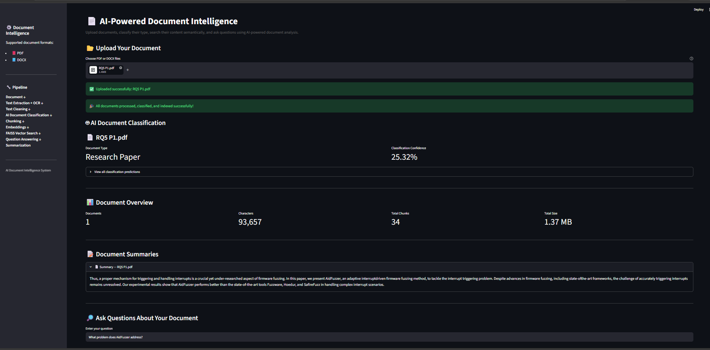
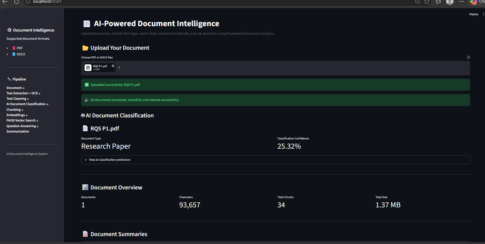
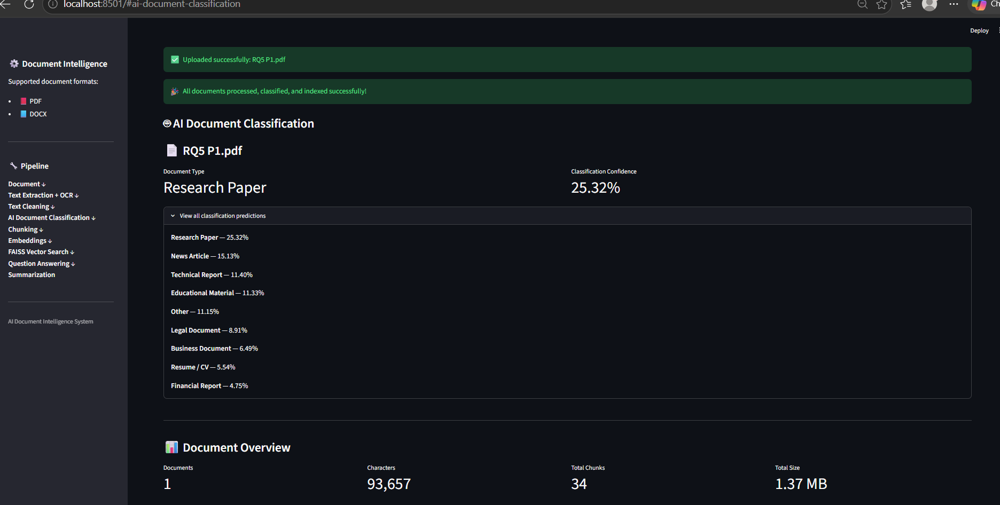
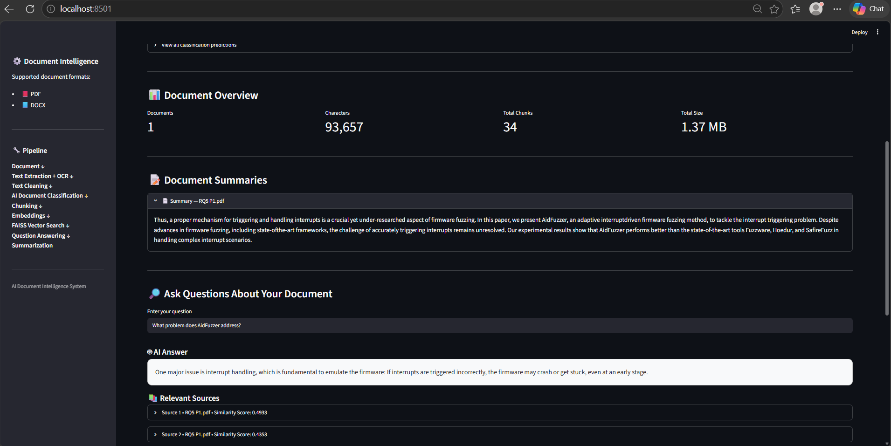

# 📄 AI-Powered Document Intelligence

An AI-powered document intelligence system for processing PDF and DOCX documents, extracting and cleaning text, handling scanned PDFs with OCR, classifying documents, generating extractive summaries, performing semantic search, and answering questions using retrieved document context.

---

## 🚀 Features

- 📕 PDF document support
- 📘 DOCX document support
- 🔍 OCR fallback for scanned PDF pages
- 🧹 Automated text cleaning and preprocessing
- ✂️ Overlapping text chunking
- 🧠 Sentence-transformer embeddings
- 🔎 Semantic document search
- ⚡ FAISS vector similarity search
- 🏷️ Transformer-based zero-shot document classification
- 📝 Extractive document summarization
- 🤖 Source-grounded question answering
- 📚 Relevant source retrieval with similarity scores
- 📊 Document processing statistics
- 🌐 Interactive Streamlit web interface
- 📝 Application logging and error handling
- 🧪 Automated pytest test suite

---

## 🚀 Live Demo

👉 [Open the Live Application](https://mdsakib-document-intelligence.streamlit.app)

---

## 🏗️ System Architecture

    Document Upload
           │
           ▼
    PDF / DOCX Extraction
           │
           ▼
    OCR Fallback for Scanned PDF Pages
           │
           ▼
    Text Cleaning
           │
           ▼
    Document Classification
           │
           ▼
    Text Chunking
           │
           ▼
    Sentence Embeddings
           │
           ▼
    FAISS Vector Index
           │
           ▼
    Semantic Search
           │
      ┌────┴────┐
      ▼         ▼
    Question   Summarization
    Answering
      │
      ▼
    Relevant Sources

---

## 🛠️ Technologies Used

| Technology | Purpose |
|---|---|
| Python | Core programming language |
| Streamlit | Interactive web application |
| PyMuPDF | PDF text extraction |
| python-docx | DOCX text extraction |
| Tesseract OCR | OCR for scanned PDF pages |
| pytesseract | Python interface for Tesseract |
| pdf2image | Convert PDF pages to images for OCR |
| Poppler | PDF rendering for OCR |
| Pillow | Image processing |
| Sentence Transformers | Semantic embedding generation |
| FAISS | Vector similarity search |
| Hugging Face Transformers | Zero-shot document classification |
| NumPy | Numerical processing |
| pytest | Automated testing |

---

## 📂 Project Structure

    AI-Document-Intelligence/
    │
    ├── app/
    │   └── app.py
    │
    ├── data/
    │   ├── sample.pdf
    │   ├── ocr_test.pdf
    │   └── uploads/
    │
    ├── screenshots/
    │   ├── 02_Document_Overview.png
    │   ├── 03_Document_Classification.png
    │   ├── 05_Full_Application.png
    │   └── RQ5_01_AidFuzzer_Addressed_Problem.png
    │
    ├── src/
    │   ├── document_processor.py
    │   ├── document_classifier.py
    │   ├── text_processor.py
    │   ├── vector_search.py
    │   ├── qa_engine.py
    │   ├── summary_engine.py
    │   ├── logger.py
    │   └── main.py
    │
    ├── tests/
    │   ├── test_document_processor.py
    │   ├── test_document_classifier.py
    │   ├── test_text_processor.py
    │   ├── test_vector_search.py
    │   ├── test_qa_engine.py
    │   ├── test_summary_engine.py
    │   └── test_logger.py
    │
    ├── .gitignore
    ├── requirements.txt
    ├── README.md
    └── LICENSE

---

## ⚙️ Installation

### 1. Clone the repository

    git clone https://github.com/mdsakibhasan-cs/AI-Document-Intelligence.git
    cd AI-Document-Intelligence

### 2. Create a virtual environment

    python -m venv .venv

### 3. Activate the virtual environment

#### Windows PowerShell

    .venv\Scripts\activate

#### Windows Command Prompt

    .venv\Scripts\activate

### 4. Install Python dependencies

    pip install -r requirements.txt

---

## 🔍 OCR Setup

Scanned PDF processing requires:

- **Tesseract OCR**
- **Poppler**

The application uses:

- `pytesseract` to communicate with Tesseract
- `pdf2image` to convert PDF pages into images
- Poppler for PDF page rendering

The OCR implementation automatically falls back to OCR when a PDF page does not contain an extractable text layer.

> **Note:** Tesseract and Poppler paths are environment-specific. When running the project on another computer, configure the paths in `src/document_processor.py` according to the local installation.

---

## ▶️ Running the Application

Start the Streamlit application with:

    streamlit run app/app.py --server.fileWatcherType none

The application will open in the browser.

Default local address:

    http://localhost:8501

---

## 📖 How It Works

### 1. Document Upload

Users upload PDF or DOCX documents through the Streamlit interface.

### 2. Document Text Extraction

PDF documents are processed using **PyMuPDF**, while DOCX documents are processed using **python-docx**.

The system extracts available text for downstream processing.

### 3. OCR Fallback

Some PDF documents contain scanned pages without an embedded text layer.

For such pages:

1. The PDF page is converted into an image.
2. Poppler and `pdf2image` are used for page rendering.
3. Tesseract OCR extracts text from the generated image.
4. The extracted OCR text is added to the document content.

This allows the system to process both text-based and scanned PDF documents.

### 4. Text Cleaning

Extracted text is cleaned before further processing.

The cleaning stage handles:

- Unnecessary whitespace
- Broken line structures
- Hyphenated line breaks
- PDF extraction artifacts
- Numeric-only lines
- Figure and table labels
- Common formatting noise

### 5. Document Classification

The system uses transformer-based zero-shot classification.

The current predefined categories include:

- Research Paper
- Business Document
- Technical Report
- Legal Document
- Educational Material
- Financial Report
- News Article
- Resume / CV
- Other

The classification module uses:

    facebook/bart-large-mnli

### 6. Text Chunking

The cleaned document is divided into overlapping chunks.

Overlapping chunks help preserve contextual information between neighboring sections while making retrieval more manageable.

### 7. Sentence Embeddings

Each chunk is converted into a numerical vector representation using:

    sentence-transformers/all-MiniLM-L6-v2

These embeddings represent the semantic meaning of document content.

### 8. FAISS Vector Index

The generated embeddings are stored in a FAISS vector index.

FAISS enables efficient similarity-based retrieval between user queries and document chunks.

### 9. Semantic Search

When a user submits a question:

1. The query is converted into an embedding.
2. FAISS retrieves semantically similar document chunks.
3. Keyword overlap is also considered.
4. The retrieved candidates are ranked using the combined relevance score.

The current retrieval strategy combines:

- **70% semantic similarity**
- **30% keyword overlap**

### 10. Source-Grounded Question Answering

The retrieved document sections are passed to the question-answering engine.

The system generates an answer from the retrieved document context rather than relying on an external generative LLM.

The application also displays:

- Relevant document sections
- Source document names
- Similarity scores

This makes the answer process more transparent and traceable to the uploaded document.

### 11. Extractive Summarization

The summarization module creates a concise extractive summary from the processed document.

It prioritizes information related to:

- Main contributions
- Problems and motivation
- Methods and mechanisms
- Evaluation and results

Low-quality and duplicate sentences are filtered before producing the final summary.

---

## 🖥️ Application Interface

The application provides an interactive Streamlit-based interface where users can:

- 📂 Upload PDF and DOCX documents
- 📊 View document processing statistics
- 🏷️ View document classification results
- 📋 Inspect classification predictions
- 📝 Read generated document summaries
- 🔎 Ask natural-language questions
- 🤖 Receive source-grounded answers
- 📚 Inspect relevant document sources
- 📈 View similarity scores

### 📸 Full Application

### 📊 Document Overview

### 🏷️ Document Classification

### 🤖 Question Answering

---

## 🔬 Example Query

After uploading a research paper, users can ask questions about its content.

**Example question:**

> What problem does AidFuzzer address?

The system retrieves relevant sections from the uploaded document and produces a source-grounded answer.

The interface also displays the relevant source sections and their similarity scores.

---

## 🧪 Testing

The project includes an automated `pytest` test suite covering the major components of the system.

Test coverage includes:

- PDF extraction
- OCR-aware document processing
- DOCX extraction
- Text cleaning
- Text chunking
- Semantic vector search
- Document classification
- Question answering
- Document summarization
- Logging

The current verified test suite:

    20 passed

---

## 🎯 Project Goals

The main goals of this project are to:

- Build a practical document intelligence system for PDF and DOCX files
- Support both text-based and scanned PDF documents
- Automatically classify uploaded documents
- Generate concise extractive summaries
- Enable semantic search over unstructured document content
- Retrieve information based on semantic meaning
- Provide source-grounded question answering
- Demonstrate sentence embeddings and vector similarity search
- Provide an interactive web interface
- Maintain a modular and extensible architecture

---

## 🔮 Future Improvements

Potential future improvements include:

- 🤖 Integration of a generative LLM for more advanced question answering
- 💬 Multi-turn conversational document chat
- 📚 Multi-document semantic search
- 🌐 Support for additional document formats
- ⚡ Advanced retrieval and reranking
- 🔐 User authentication and document access control
- ☁️ Cloud-based storage and deployment
- 📊 Advanced document analytics and visualization
- 🌍 Improved multilingual OCR configuration
- 🚀 Production-oriented deployment and scalability improvements

---

## 📌 Current Limitations

The current version has several limitations:

- OCR depends on locally installed Tesseract and Poppler binaries.
- OCR accuracy depends on the quality, resolution, and layout of scanned documents.
- Question-answering quality depends on the relevance and quality of retrieved document chunks.
- The current QA system is source-grounded and does not use a generative LLM.
- Document classification relies on predefined zero-shot categories.
- Authentication and document access control are not currently implemented.
- The application is primarily designed as a local prototype and has not yet been deployed as a production service.

---

## 👨‍💻 Author

**Md Sakib Hasan**

Computer Science and Technology  
Nantong University, China

### Areas of Interest

- Artificial Intelligence
- Machine Learning
- Data Science
- Natural Language Processing
- Software Engineering
- Cyber Security
- Networking
- Embedded Systems
- Intelligent Systems

---

## 📄 License

This project is licensed under the **MIT License**.