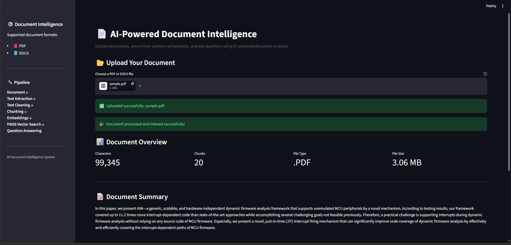
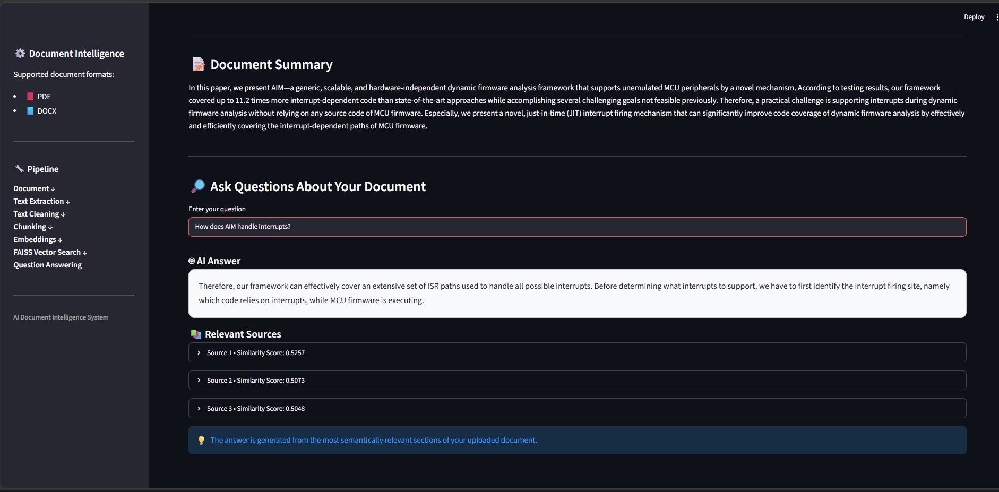

# 📄 AI-Powered Document Intelligence

An AI-powered document intelligence system for processing PDF and DOCX documents, extracting and cleaning text, classifying documents, generating extractive summaries, performing semantic search, and answering questions using retrieved document context.

---

## 🚀 Features

- 📕 PDF document support
- 📘 DOCX document support
- 🔍 OCR support for scanned PDF documents
- 🧹 Automated text cleaning
- ✂️ Intelligent overlapping text chunking
- 🧠 Sentence-transformer embeddings
- 🔎 Semantic document search
- ⚡ FAISS vector similarity search
- 🏷️ Transformer-based document classification
- 📝 Extractive document summarization
- 🤖 Context-based question answering
- 📚 Relevant source retrieval with similarity scores
- 📊 Document processing statistics
- 🌐 Interactive Streamlit web interface
- 📝 Application logging and error handling
- 🧪 Automated test suite

---

## 🏗️ System Architecture

```text
                 Document Upload
                       │
                       ▼
              PDF / DOCX Extraction
                       │
                       ▼
              OCR for Scanned PDFs
                       │
                       ▼
                 Text Cleaning
                       │
                       ▼
             Document Classification
                       │
                       ▼
                  Text Chunking
                       │
                       ▼
              Sentence Embeddings
                       │
                       ▼
               FAISS Vector Index
                       │
                       ▼
                 Semantic Search
                       │
                       ▼
           Context-Based Question Answering
                       │
                       ▼
            Extractive Document Summary
```

---

## 🛠️ Technologies Used

| Technology | Purpose |
|------------|---------|
| Python | Core programming language |
| Streamlit | Interactive web application interface |
| PyMuPDF | PDF text extraction |
| python-docx | DOCX text extraction |
| Tesseract OCR | OCR for scanned PDF pages |
| pytesseract | Python interface for Tesseract OCR |
| pdf2image | Convert PDF pages into images for OCR |
| Poppler | PDF rendering for OCR |
| Pillow | Image processing |
| Sentence Transformers | Text embedding generation |
| FAISS | Vector similarity search |
| Hugging Face Transformers | Transformer-based document classification |
| NumPy | Numerical processing |
| pytest | Automated testing |

---

## 📂 Project Structure

```text
AI-Document-Intelligence/
│
├── app/
│   └── app.py
│
├── src/
│   ├── document_processor.py
│   ├── document_classifier.py
│   ├── text_processor.py
│   ├── vector_search.py
│   ├── qa_engine.py
│   ├── summary_engine.py
│   ├── logger.py
│   └── main.py
│
├── tests/
│   ├── test_document_processor.py
│   ├── test_document_classifier.py
│   ├── test_text_processor.py
│   ├── test_vector_search.py
│   ├── test_qa_engine.py
│   ├── test_summary_engine.py
│   └── test_logger.py
│
├── screenshots/
│   ├── app-overview.png
│   └── question-answering.png
│
├── .gitignore
├── requirements.txt
├── README.md
└── LICENSE
```

---

## ⚙️ Installation

### 1. Clone the repository

```bash
git clone https://github.com/mdsakibhasan-cs/AI-Document-Intelligence.git
cd AI-Document-Intelligence
```

### 2. Create a virtual environment

```bash
python -m venv .venv
```

### 3. Activate the virtual environment

#### Windows PowerShell

```powershell
.venv\Scripts\activate
```

#### Windows Command Prompt

```cmd
.venv\Scripts\activate
```

### 4. Install Python dependencies

```bash
pip install -r requirements.txt
```

### 5. Install OCR Dependencies

Scanned PDF OCR requires:

- **Tesseract OCR**
- **Poppler**

The application currently uses locally installed Tesseract and Poppler binaries for OCR processing.

> **Note:** Tesseract and Poppler installation paths are environment-specific. When running the project on another computer, their paths may need to be configured in `src/document_processor.py`.

---

## ▶️ Running the Application

Start the Streamlit application with:

```bash
streamlit run app/app.py --server.fileWatcherType none
```

The application will open in your default web browser.

Local address:

```text
http://localhost:8501
```

---

## 📖 How It Works

The system processes uploaded documents through a modular document intelligence pipeline.

### 1. Document Upload

Users can upload PDF or DOCX documents through the Streamlit web interface.

### 2. Document Text Extraction

PDF documents are processed using **PyMuPDF**, while DOCX documents are processed using **python-docx**.

The system extracts available text from uploaded documents for downstream processing.

### 3. OCR for Scanned PDFs

Some PDF documents contain scanned pages without an embedded text layer.

When a PDF page does not contain extractable text, the system automatically attempts OCR.

The page is converted into an image using `pdf2image` and Poppler, and Tesseract OCR is used to extract the text.

This allows the system to process scanned and image-based PDF pages.

### 4. Text Cleaning

Extracted document text is cleaned before further processing.

The cleaning stage handles:

- Unnecessary whitespace
- Broken line structures
- Hyphenated line breaks
- PDF extraction artifacts
- Unwanted numeric-only lines
- Figure and table labels
- Common document formatting noise

### 5. Document Classification

The system includes a transformer-based zero-shot document classification module.

Documents can be classified into predefined categories such as:

- Research Paper
- Business Document
- Technical Report
- Legal Document
- Educational Material
- Financial Report
- News Article
- Resume / CV
- Other

The classification module uses the Hugging Face:

```text
facebook/bart-large-mnli
```

model.

### 6. Text Chunking

After cleaning, the document is divided into smaller overlapping text chunks.

Chunking allows the retrieval system to work with manageable sections of the document instead of searching the entire document as one large text block.

### 7. Sentence Embeddings

Each text chunk is converted into a numerical vector representation using a Sentence Transformer model.

These embeddings represent the semantic meaning of the document content.

### 8. Vector Indexing

The generated embeddings are stored in a FAISS vector index.

FAISS enables efficient similarity-based retrieval between a user's question and the document chunks.

### 9. Semantic Search

When a user enters a question, the question is converted into an embedding.

The system searches the FAISS index and retrieves the most relevant document chunks.

The retrieval process combines semantic similarity with keyword overlap to improve the relevance of retrieved content.

### 10. Context-Based Question Answering

The retrieved document sections are passed to the source-grounded question-answering engine.

The system generates an answer based on the retrieved document content rather than depending on an external generative LLM.

Relevant source sections are also displayed to the user together with their similarity scores.

### 11. Extractive Document Summarization

The summarization module generates a concise extractive summary from the processed document.

It identifies important sentences using signals related to:

- Main contributions
- Problems and motivation
- Methods and mechanisms
- Evaluation and results

The module also removes duplicate or low-quality sentences before producing the final summary.

---

## 🖥️ Application Interface

The application provides an interactive web-based interface built with Streamlit.

Users can:

- 📂 Upload PDF or DOCX documents
- 📊 View document processing statistics
- 🏷️ View document classification results
- 📝 Read an automatically generated document summary
- 🔎 Ask natural-language questions about the document
- 🤖 Receive context-based answers
- 📚 View relevant document sources
- 📈 Inspect similarity scores for retrieved content

### 📊 Document Overview

The application provides a clean interface for uploading and analyzing PDF and DOCX documents.

The document overview provides processing information and displays the generated document analysis and summary.



### 🔎 Question Answering

Users can ask natural-language questions about the uploaded document.

The system performs semantic retrieval using FAISS and returns a context-based answer together with relevant document sections and similarity scores.



---

## 🔬 Example Query

After uploading a document, users can ask questions related to its content.

**Example question:**

> How does AIM handle interrupts?

The system performs semantic search across the uploaded document, retrieves the most relevant sections, and generates a context-based answer.

The interface also displays the retrieved source sections together with their similarity scores.

---

## 🧪 Testing

The project includes an automated pytest test suite covering the major components of the system.

The test suite covers:

- Document processing
- PDF extraction
- OCR-aware document processing
- DOCX extraction
- Text cleaning
- Text chunking
- Semantic vector search
- Document classification
- Question answering
- Document summarization
- Logging

The current verified test suite passes successfully:

```text
20 passed
```

---

## 🎯 Project Goals

The main goals of this project are to:

- Build a practical document intelligence system for PDF and DOCX files
- Support both text-based and scanned PDF documents
- Automatically classify uploaded documents
- Generate concise extractive document summaries
- Enable semantic search over unstructured document content
- Retrieve relevant information based on query meaning
- Provide source-grounded question answering
- Demonstrate the use of sentence embeddings and vector similarity search
- Provide an interactive and user-friendly web interface
- Maintain a modular architecture that can be extended with additional AI capabilities

---

## 🔮 Future Improvements

Potential future improvements include:

- 🤖 Integration of a generative LLM for more advanced question answering
- 💬 Conversational multi-turn document chat
- 📚 Multi-document semantic search
- 🌐 Support for additional document formats
- ⚡ More advanced retrieval and reranking strategies
- 🔐 User authentication and document access control
- ☁️ Cloud-based document storage and deployment
- 📊 Advanced document analytics and visualization
- 🌍 Improved multilingual OCR configuration
- 🚀 Production-oriented deployment and scalability improvements

---

## 📌 Current Limitations

The current version of the system has the following limitations:

- OCR depends on locally installed Tesseract OCR and Poppler binaries.
- OCR accuracy depends on the quality, resolution, and layout of scanned documents.
- The current question-answering module is source-grounded and does not use a generative LLM.
- Answer quality depends on the relevance and quality of the retrieved document chunks.
- The system currently processes one uploaded document at a time.
- Document classification uses predefined zero-shot categories.
- Authentication and access control are not currently included.
- The application is primarily designed as a local prototype and has not yet been deployed as a production service.

---

## 👨‍💻 Author

**Md Sakib Hasan**

Computer Science and Technology  
Nantong University, China

### Areas of Interest

- Artificial Intelligence
- Data Science
- Machine Learning
- Natural Language Processing
- Software Engineering
- Cyber Security
- Networking
- Embedded Systems
- Intelligent Systems

---

## 📄 License

This project is licensed under the MIT License.